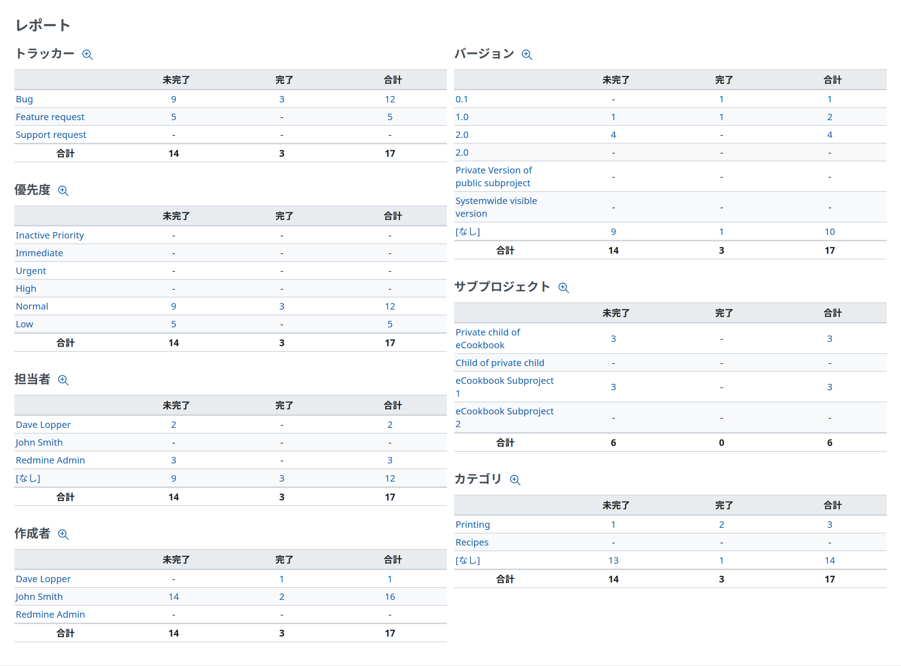
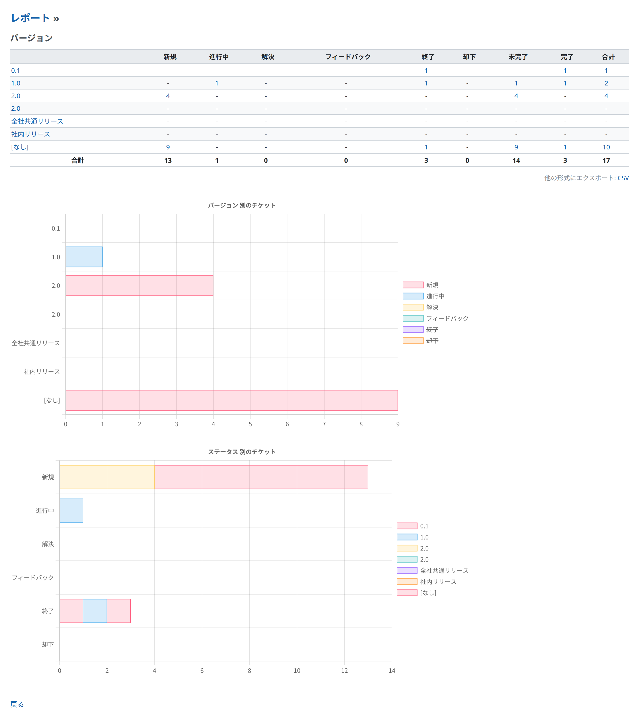

# チケットのレポート

## 概要

チケットのレポートは、プロジェクト単位で、すべてのチケットの数をまとめたレポートです (これに対して、バージョンのページはバージョン単位の概要です)。レポートはいくつかの欄に分かれ、それぞれの欄には、次の項目ごとに未完了、完了、合計のチケットの数が表示されます。

- トラッカー
- 優先度
- チケットを担当しているユーザー
- チケットを作成したユーザー (作成者)
- バージョン
- サブプロジェクト (プロジェクトにサブプロジェクトがあるときだけ)
- カテゴリ

## ドリルスルーのリンク

トラッカー、優先度、担当者、作成者、バージョン、カテゴリのそれぞれが、選んだ項目をフィルタに設定した[チケット一覧](issue-list.md)へのリンクになっています。\
レポートのチケットの数も、[チケット一覧](issue-list.md)のそれぞれの表示へのドリルスルーのリンクになっています。

## 詳細なレポート

レポートの欄を選ぶと、その欄の詳細なレポートが表示されます。詳細なレポートには、未完了、完了、合計のチケットの数だけでなく、設定したほかのすべての[チケットのステータス](../admin/issue-tracking-setup.md#Issue-statuses)ごとの数も表示されます。下のスクリーンショットは、バージョンの詳細なレポートです。

