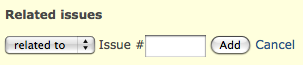
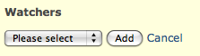
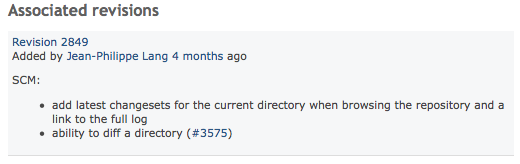
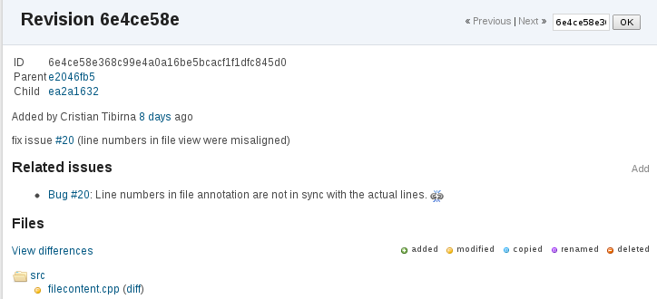
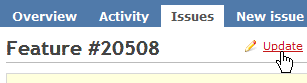
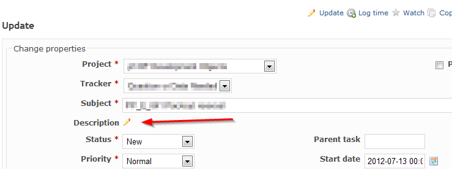
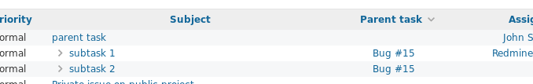
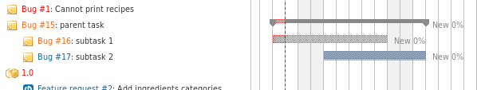

# チケットトラッキング

チケットは Redmine の中心です。チケットはプロジェクトに属し、ユーザーが所有し、バージョンに関連付けることなどができます。

## チケットの表示

チケットのページでは、そのチケットを解決するために進めている作業を確認できます。メッセージは時系列で表示されます(順序を変えるには、「個人設定」の「コメントの表示順」を参照してください)。ほかの人のメッセージを引用したり、自分のメッセージを編集したりできます。

### 関連するチケット

「関連するチケット」を使うと、開発者はチケット同士を関連付けて、重複をなくしたり、ワークフローを簡単にしたりできます。

チケットは、さまざまな関連で関連付けられます。現在の関連は次のとおりです。

- **関連している** - ほかのチケットへのリンクを追加するだけです。
- **次のチケットと重複** - 「重複しているチケットを連動して終了」の設定が有効なとき (デフォルト) に、一方を終了すると、もう一方も終了するようにチケットを関連付けます(例: A を終了すると B も終了します)\
  たとえば、チケット B が A と**重複**している場合:\
  - B を終了しても、A は未完了のままです\
  - A を終了すると、B も自動で終了します
- **次のチケットが重複** - 「次のチケットと重複」の逆です。\
  たとえば、チケット A にチケット B が**重複**している場合:\
  - B を終了しても、A は未完了のままです\
  - A を終了すると、B も自動で終了します
- **ブロック先** - まだ未完了のチケットによって、一方の終了をブロックできるようにチケットを関連付けます\
  チケット B が A をブロックしている場合、\
  B が終了するまで A は終了できません。
- **ブロック元** - 「ブロック先」の逆です。
- **次のチケットに先行** - 「順序」を決めるようにチケットを関連付けます。A は、B を開始できる日の x 日前までに完了する必要があります\
  B が A に後続している場合、B の開始日を\
  A の終了日と同じか、それより前の日付には\
  できません。
- **次のチケットに後続** - 「次のチケットに先行」の逆です。\
  チケット B が A に後続していて(例: A が 21/04 に終わり、B が 22/04 に始まる)、\
  A の終了日に 2 日を足すと、\
  B の開始日と終了日も 2 日ずつ後ろにずれます。
- **コピー元** - チケットがコピーされたものかどうかと、どのチケットからコピーされたかがわかるように関連付けます。
- **コピー先** - 「コピー元」の逆です。

管理者は、こうした関連を追加、編集するユーザーの[権限](../admin/roles.md#Permissions)を設定できます。

### ウォッチャー

このチケットをウォッチしているすべてのユーザーの一覧を表示します。チケットが更新されると、これらのユーザーに通知されます。

ロールに「ウォッチャーの追加」の権限があれば、このページでウォッチャーの一覧にユーザーを追加できます。「追加」のリンクをクリックすると、「ユーザーの検索:」の欄とユーザーの一覧のあるダイアログが表示されます。ウォッチャーの一覧に追加するユーザーにチェックを入れ、「追加」のボタンをクリックします。

管理者は、ウォッチャーの追加と削除、ウォッチャーの一覧の閲覧についてのユーザーの[権限](../admin/roles.md#Permissions)を設定できます。

### 関係しているリビジョン

管理者が[「参照用キーワード」](../admin/settings.md#Referencing-issues-in-commit-messages)を設定していれば、開発者がそのキーワードを使ったコミットメッセージが、チケットの履歴の「関係しているリビジョン」のタブに表示されます。

リビジョンは、リポジトリブラウザーの更新履歴(リビジョン)の画面から、手動でチケットに関連付けることもできます。手動の関連付けは元に戻せます。同じくその画面で、追加した関連付けの右にある、切れた鎖のアイコンを使って解除できます。

## 新しいチケットの追加

Redmine の管理者が設定した[ロールと権限](../admin/roles.md)の条件を満たしていれば、新しいチケットを作成できます([ロール: 「チケットトラッキング」 > 「チケットの追加」](../admin/roles.md#Permissions))。\
新しいチケットを作成するとき、特に重要な項目の 1 つが、チケットの性質を決める[「トラッカー」のフィールド](../admin/issue-tracking-setup.md#Trackers)です。Redmine には、デフォルトで「バグ」、「機能」、「サポート」の 3 つのトラッカーがあります。

## 既存のチケットの更新

(TODO: 更新のパネルを説明し、そのスクリーンショットをアップロードする)

チケットを編集するには、チケットのページの上か下にある「編集」のリンク(鉛筆のアイコン)をクリックします。

ロールの権限([ロールと権限](../admin/roles.md)を参照)によって、編集できるチケットの属性がすべて表示されるか、一部だけが表示されます。

## 既存のチケットの題名や説明の編集

既存のチケットを編集するには、[ロールと権限](../admin/roles.md)の設定で、自分のロールに[「チケットトラッキング」 > 「チケットの編集」](../admin/roles.md#Permissions)の権限が必要です。

1.  チケットを開きます
2.  チケットのページの上か下にある「編集」のリンク(ペンのアイコン)をクリックします。

チケットの説明のすぐ横に鉛筆のアイコンがあり、クリックすると説明を変更できます。

## 子チケット

大きなタスクを小さな子チケットに分けると、タスクを管理しやすくなったり、小さな部分を別々のユーザーに割り当てたりできて便利なことがあります。子チケットは、親チケットの「子チケット」の欄にある「追加」のリンクをクリックするか、子チケットの「親チケット」のフィールドに親チケットの ID を入力して作成します。作成したあとでも、[チケットを更新](issues.md#Updating-an-existing-issue)して設定できます。子チケットも普通のチケットなので、子チケットに子チケットを持たせることもできます。この階層の深さに制限はありません。

子チケットは、親チケットと別のプロジェクトに属せます。この機能は、管理メニューの[設定](../admin/settings.md#Allow-cross-project-subtasks)で設定できます。子チケットを設定するには「子チケットの管理」の権限が必要です。この権限は、管理メニューの[ロールと権限](../admin/roles.md)で設定できます。\
プロジェクトをコピーすると、親チケットの下のツリー全体もコピーされます。親チケットだけをコピーするときは、子チケットもコピーするかどうかを選べます。

### フィルタと並べ替え

チケット一覧に、親チケットの ID を並べ替えのできる列として表示できます。フィルタの条件にも使えます。\
一覧を親チケットの ID で並べ替えると、子チケットの階層がインデントしたツリーで表示されます。\

チケットの対象バージョンが同じであれば、ガントチャートでもツリー構造が表示されます。\

### 親チケットと子チケットの関係

親チケットのいくつかの属性は、その下の子チケットの影響を受けます。\
親チケットと子チケットには、次の関係があります。

- 親チケットの進捗率は、子チケットの進捗率を予定工数で重み付けした平均です (終了した子チケットは 100% として数えます)。
- 親チケットの開始日は、子チケットの開始日のうち最も早い日付です。
- 親チケットの期日は、子チケットの期日のうち最も遅い日付です。
- 親チケットの作業時間には、親チケット自身の作業時間と、子チケットの作業時間を含めた合計が表示されます。
- 親チケットの予定工数には、親チケット自身の予定工数と、子チケットの予定工数を含めた合計が表示されます。
- 親チケットの優先度は、未完了の子チケットの優先度のうち最も高いものです。
- 親チケットに「次のチケットに先行」の関連を設定すると、子チケットの日程が変更されます。

日付、優先度、進捗率は、デフォルトでは子チケットの値から算出されます。それぞれ、「親チケットの値の算出方法」の設定 (「管理」 > 「設定」 > 「チケットトラッキング」) で「子チケットから独立」にできます。
