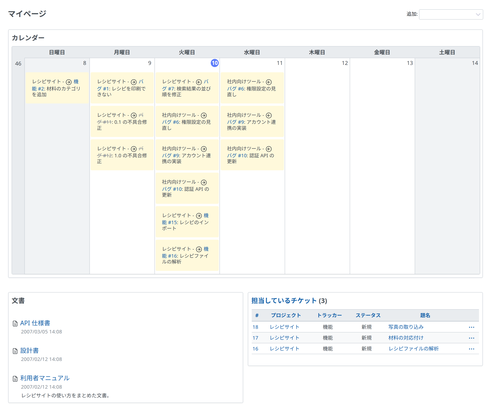

# マイページ

「マイページ」には、プロジェクトについてのさまざまな情報をブロックとして表示できます。ブロックを追加、削除、並べ替えて、自分の「マイページ」を作れます。

## ブロック

次のブロックのほか、「更新したチケット」と「活動」のブロックを使えます。最初に表示されるのは「担当しているチケット」と「報告したチケット」のブロックだけです。

「マイページ」のレイアウト (ブロックの配置) は、ドラッグ・アンド・ドロップで並べ替えたり変えたりできます。

### 担当しているチケット

「担当しているチケット」のブロックには、いまのユーザーが担当しているチケットを、プロジェクトをまたいで一覧にします。デフォルトでは、プロジェクト、トラッカー、ステータス、題名が表示されます (表示する項目はブロックの「オプション」で変更できます)。

### 報告したチケット

「報告したチケット」のブロックには、いまのユーザーが報告したチケットを、プロジェクトをまたいで一覧にします。デフォルトでは、プロジェクト、トラッカー、ステータス、題名が表示されます (表示する項目はブロックの「オプション」で変更できます)。

### カレンダー

「カレンダー」のブロックには、プロジェクトをまたいだ 1 週間のカレンダーが表示されます。

### 文書

「文書」のブロックには、プロジェクトをまたいだ最新の文書が表示されます。

### チケット

「チケット」のブロックには、選んだカスタムクエリのチケットを一覧にします。

### 最新ニュース

「最新ニュース」のブロックには、プロジェクトをまたいだ最新のニュースが表示されます。

### 作業時間

「作業時間」のブロックには、いまのユーザーが過去 7 日間に記録した作業時間を、プロジェクトをまたいで表示します (日数はブロックの「オプション」で変更できます)。

### ウォッチしているチケット

「ウォッチしているチケット」のブロックには、いまのユーザーがウォッチしているチケットを、プロジェクトをまたいで一覧にします。デフォルトでは、プロジェクト、トラッカー、ステータス、題名が表示されます (表示する項目はブロックの「オプション」で変更できます)。
