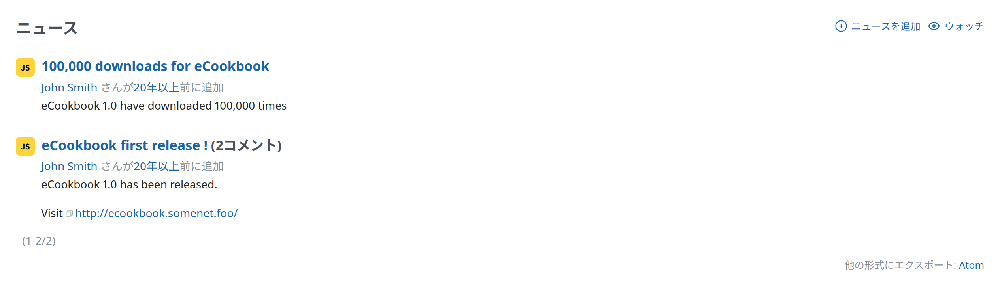

# ニュース

「ニュース」では、プロジェクトや任意の話題のニュースを公開できます。

ニュースには、タイトル、サマリー、詳しい説明を付けます。サマリーはプロジェクトの[概要](project-overview.md)の「最新ニュース」の欄に表示され、説明はニュースのタイトルをクリックすると表示されます。

ニュースを作成する[権限](../admin/roles.md#Permissions)があれば、ニュースを追加、編集、削除できます([Redmine の権限を参照](../admin/roles.md#Permissions))。

新しいニュースを作成する[権限](../admin/roles.md#Permissions)があれば、画面の右上に「ニュースを追加」のリンクが表示されます。これをクリックすると、ニュースの一覧の上に、ニュースを追加するフォームが開きます。このフォームで、ニュースの「タイトル」と「説明」を入力します。「サマリー」は省略できます。

