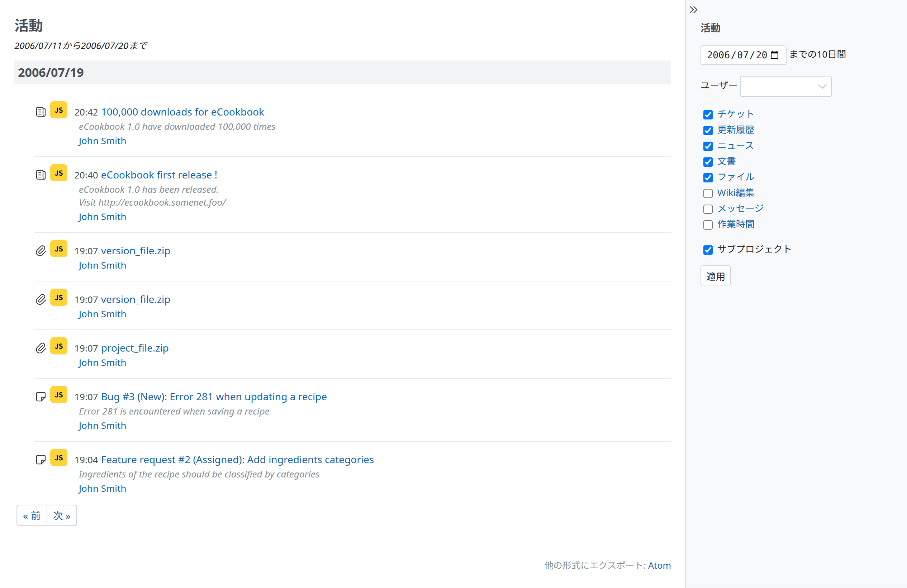

# 活動

「活動」のページには、そのプロジェクトで起きたことの履歴が表示されます。

次のようなものが含まれます。

- 新しいチケット(機能、バグなど)が作成された
- チケットのステータスが変更された
- チケットが完了した
- チケットに注記が追加された
- リポジトリに新しいリビジョンがコミットされた
- ニュースが追加された
- フォーラムにメッセージが追加された
- フォーラムのメッセージに返信が追加された
- Wiki のページが編集または作成された
- 「ファイル」または文書に新しいファイルが追加された
- 新しい文書が追加された
- 作業時間が記録された

右のサイドバーのチェックボックスで、表示する項目を選べます。

活動は Atom のフィードでも取得できます。

「プロジェクト」のページからは、すべてのプロジェクトをまたいだ活動を見られます。表示できるすべてのプロジェクトの活動が一覧になります。
