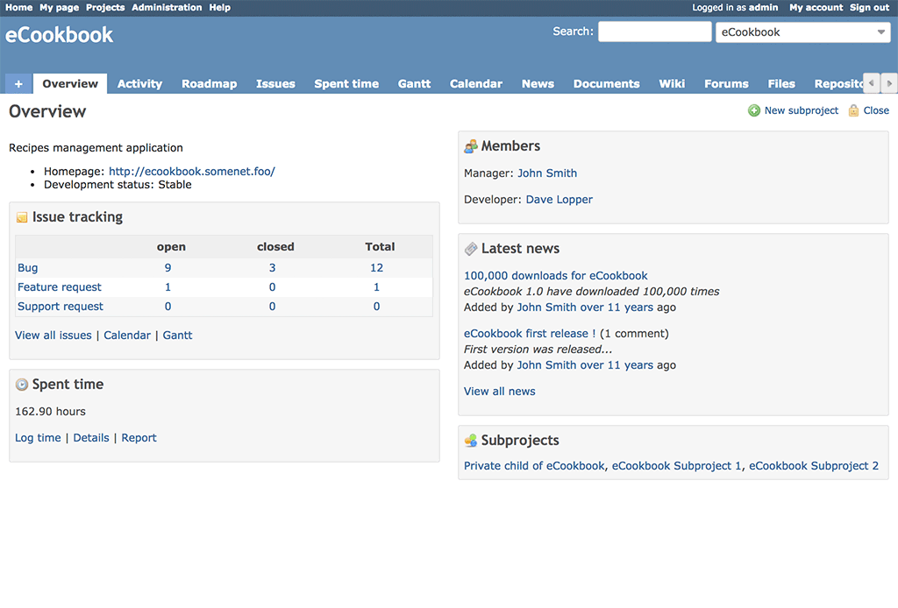

# 概要

プロジェクトの「概要」では、プロジェクト全体を見渡せます。左上の「チケットトラッキング」の欄には、プロジェクトに設定した[トラッカー](../admin/issue-tracking-setup.md)ごとに、未完了と完了のチケットの数が表示されます。「メンバー」の欄では、プロジェクトのメンバーと、特にプロジェクトの管理者が誰かを確認できます。「最新ニュース」の欄には、そのプロジェクトの最近のニュースが表示されます。

TODO: チケットのトラッカーと設定について書く…

右上には「[ログイン](login.md)」と「[登録する](register.md)」があります。「[ログイン](login.md)」のリンクから、このプロジェクトのアカウントを持っている人がログインします。「[登録する](register.md)」のリンクから、登録していないユーザーが自分で登録し、この Redmine にあるプロジェクトに参加できるようになります。

「[登録する](register.md)」のリンクは、管理者が無効にできます。

TODO: ほかの欄へのリンクを作る…
