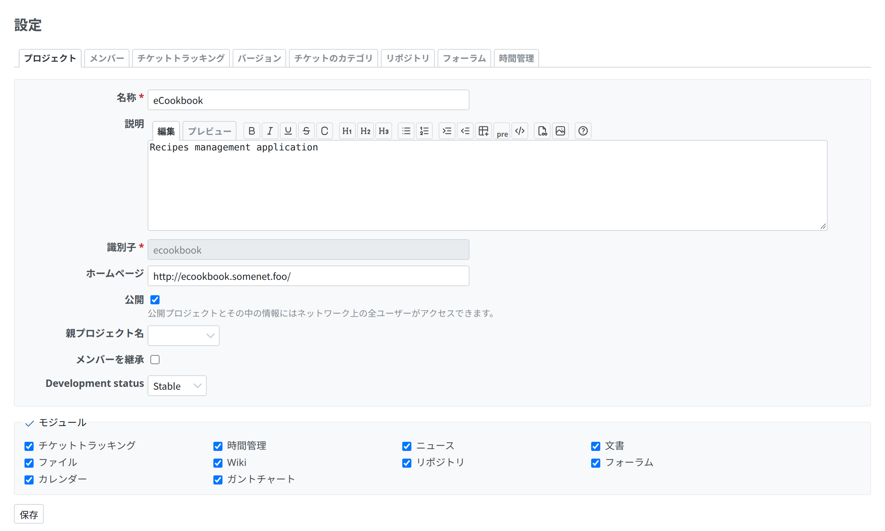

# プロジェクト設定

プロジェクトで必要な権限のあるメンバーは、プロジェクトの「設定」のタブでプロジェクトを設定できます。

## 情報

この画面 (「プロジェクト」のタブ) では、選んだプロジェクトの基本の(ただし重要な)設定をします。



### 全般の設定

全般の設定には、次のものがあります。

- 「名称」: プロジェクトの表示名
- 「説明」: プロジェクトの概要に表示される説明
- 「識別子」: アプリケーションのさまざまな箇所(URL など)で使われます。一意である必要があり、数字だけにはできません。プロジェクトを作成した後は、識別子を変えられません。
- 「ホームページ」: [プロジェクトの概要](project-overview.md)に表示されるホームページのリンク
- 「公開」: チェックを入れると、プロジェクトのメンバーでないユーザーも含め、すべてのユーザーがプロジェクトを見られます。チェックを外すと、プロジェクトのメンバーだけが、それぞれの[ロール](../admin/roles.md)に応じてアクセスできます。
- 「親プロジェクト名」: 作成するプロジェクトの親プロジェクトを指定します。プロジェクトは何階層でも入れ子にできます。

管理者が[プロジェクトのカスタムフィールド](../admin/custom-fields.md#Fields-for-Projects)を設定していると、そのフィールドは「親プロジェクト名」と「メンバーを継承」の設定の後に表示されます。

### トラッカー

以下のトラッカーとカスタムフィールドは、「チケットトラッキング」のタブで設定します。このタブは「チケットトラッキング」のモジュールが有効なときに表示され、プロジェクトの「デフォルトのバージョン」、「デフォルトの担当者」、「デフォルトのクエリ」も設定できます。

Redmine では、[設定したトラッカー](../admin/issue-tracking-setup.md#Trackers)(したがって、それぞれの[ワークフロー](../admin/issue-tracking-setup.md#Workflow)も)のうち、どれをこのプロジェクトで使うかを指定できます。

- 「トラッカー」: プロジェクトのチケットに使うトラッカーを選びます。新しいトラッカーを作れるのは管理者だけです。

### カスタムフィールド

- 「カスタムフィールド」: プロジェクトのチケットに使う[チケットのカスタムフィールド](../admin/custom-fields.md#Fields-for-Issues)を選びます。新しい[カスタムフィールド](../admin/custom-fields.md)を作れるのは管理者だけです。

このうち、ここで設定できる(チェックを外せるなど)のは、*全プロジェクト向け*のチケットのカスタムフィールドとして定義されて*いない*カスタムフィールドだけです(全プロジェクト向けにするには、管理者がカスタムフィールドの作成や編集の画面で「全プロジェクト向け」のチェックボックスにチェックを入れます)。

## モジュール

プロジェクトで使うモジュールは、「プロジェクト」のタブの下にある「モジュール」の欄で選びます。

モジュールを無効にしても、関連するデータは削除されません。ユーザーがアクセスできなくなるだけです。無効にしたモジュールは、すべてのデータとともに有効に戻せます。\
たとえば、1 つのプロジェクトだけ「チケットトラッキング」のモジュールを無効にできます。既存のチケットは削除されません。モジュールを有効に戻せば、チケットにアクセスできます。

### 標準のモジュール

- 「チケットトラッキング」: [チケットトラッキング](issues.md)の機能を提供します。[チケットのカテゴリ](project-settings.md#Issue-categories)、[バージョン](project-settings.md#Versions)、[ロードマップ](roadmap.md)、[バージョンの概要](version.md)を含みます
- 「時間管理」: [時間管理](time-tracking.md)の機能を提供します
- 「ニュース」: [ニュース](news.md)の機能を提供します
- 「文書」: [文書](documents.md)の機能を提供します
- 「ファイル」: [ファイル](files.md)の機能を提供します
- 「Wiki」: [Wiki](wikis.md) の機能を提供します
- 「リポジトリ」: [リポジトリ](repository.md)の機能を提供します
- 「フォーラム」: [フォーラム](forums.md)の機能を提供します
- 「カレンダー」: [カレンダー](calendar.md)の機能を提供します
- 「ガントチャート」: [ガントチャート](gantt.md)の機能を提供します

[Redmine のプラグイン](https://www.redmine.org/projects/redmine/wiki/Plugins)で、システムにモジュールを追加できます。プラグインをインストールできるのは管理者だけです。

## メンバー

この画面では、プロジェクトのメンバーとそのロールを設定します。プロジェクトに、ユーザーまたはグループを、1 つまたは複数のロールで追加できます。

## バージョン

プロジェクトのバージョンを使うと、変更を管理し、計画を立てられます。チケットをバージョンに割り当てると、バージョンごとに割り当てたチケットの一覧を[ロードマップ](roadmap.md)で見られます。\
バージョンに Wiki ページを割り当てることもできます。その Wiki ページは、[ロードマップ](roadmap.md)と[バージョンの概要](version.md)に追加されます。

*注: [ロードマップ](roadmap.md)のメニューの項目は、プロジェクトで「チケットトラッキング」の[モジュール](project-settings.md#Core-modules)が有効で、かつ[プロジェクト設定](project-settings.md)で少なくとも 1 つの[バージョン](project-settings.md#Versions)を設定しているときにだけ、プロジェクトのメニューに表示されます。*

バージョン(のそれぞれ)には、次の属性を設定できます。

- 「名称」: バージョンを識別するために表示するテキストです。*このフィールドは必須です。*
- 「説明」: バージョンの短い説明です。*このフィールドは省略できます。*
- 「ステータス」: バージョンへのチケットの割り当て方を制御します。
  - 「進行中」: 制限なし(デフォルト)
  - 「ロック中」: 新しいチケットをバージョンに割り当てられません
  - 「終了」: 新しいチケットを割り当てられず、割り当て済みのチケットを再び未完了にできません
- 「Wikiページ」: バージョンに割り当てる Wiki ページの名前です。*このフィールドは省略できます。*
- 「期日」: バージョンを完了する期日です。*このフィールドは省略できます。*
- 「共有」: このオプションで、バージョンをほかのプロジェクトと共有できます。ほかのプロジェクトのチケットを、共有したバージョンに割り当てられるようになります。それぞれのバージョンは、次の範囲で共有できます。
  - 「サブプロジェクト単位」: すべての子孫のプロジェクト
  - 「プロジェクト階層単位」: 祖先と子孫のプロジェクト(ルートのプロジェクトで「バージョンの管理」の権限が必要です)
  - 「プロジェクトツリー単位」: ルートのプロジェクトとそのすべての子孫のプロジェクト(上と同じ)
  - 「すべてのプロジェクト」(管理者のユーザーだけが設定できます)

```text
------------------------------------------------------------------------------------------------------------------------------
| 共有しない             | サブプロジェクト単位   | プロジェクト階層単位   | プロジェクトツリー単位 | すべてのプロジェクト   |
|                        |                        |                        |                        |                        |
|          X     X       |          X     X       |          o     X       |          o     X       |          o     o       |
|          |     |       |          |     |       |          |     |       |          |     |       |          |     |       |
|        --X--   X       |        --X--   X       |        --o--   X       |        --o--   X       |        --o--   o       |
|       /  |  \          |       /  |  \          |       /  |  \          |       /  |  \          |       /  |  \          |
|      X   V   X         |      X   V   X         |      X   V   X         |      o   V   o         |      o   V   o         |
|         / \            |         / \            |         / \            |         / \            |         / \            |
|        X   X           |        o   o           |        o   o           |        o   o           |        o   o           |
|       /                |       /                |       /                |       /                |       /                |
|      X                 |      o                 |      o                 |      o                 |      o                 |
------------------------------------------------------------------------------------------------------------------------------

V = 共有したバージョンのあるプロジェクト
o = 共有したバージョンにチケットを割り当てられるプロジェクト
X = 共有したバージョンにチケットを割り当てられないプロジェクト
```

非公開のプロジェクトのバージョンを公開のプロジェクトと共有すると、そのバージョンの名前は全員に見えるようになります。

バージョンの一覧で「完了したバージョンを終了にする」をクリックすると、完了したすべてのバージョン(期日を過ぎ、未完了のチケットがないもの)のステータスを自動で*終了*にできます。

## チケットのカテゴリ

チケットのカテゴリを使うと、チケットを整理できます。たとえば、カテゴリをプロジェクトのさまざまなコンポーネントに対応させられます。

チケットのカテゴリは、プロジェクトごとに独自に設定できます。新しく作成したチケットを、選んだカテゴリに応じて特定のユーザーに自動で割り当てることもできます。

チケットのカテゴリ(のそれぞれ)には、次の属性を設定できます。

- 「名称」: チケットのカテゴリを識別するために表示するテキストです。*このフィールドは必須です。*
- 「担当者」: このカテゴリで新しく作成したチケットを自動で割り当てる、プロジェクトのメンバーです。*このフィールドは省略できます。*

## Wiki

プロジェクトごとに Wiki を持てます。Wiki を使うには、そのプロジェクトで[モジュール](project-settings.md#Modules)を有効にします。

- 「メインページ」: プロジェクトのメニューの Wiki のリンクと、[Wiki のサイドバー](wikis.md#Sidebar)の「メインページ」のリンクの両方で、Wiki のメインページとして使われるページです(デフォルト: 「Wiki」)。ほかのページをメインページにするには、そのページを開いて「名前変更」をクリックし、「メインページ」にチェックを入れます (「Wikiの管理」の権限が必要です)。

## リポジトリ

プロジェクトごとに SCM のリポジトリを 1 つ以上関連付けられます (「リポジトリ」のタブ)。リポジトリを設定すると、リポジトリを閲覧し、更新履歴を見られます。更新履歴は[活動](project-activity.md)の画面にも表示されます。\
Redmine でのリポジトリの設定について詳しくは、[こちらのページ](../admin/repositories.md)を参照してください。

## フォーラム

プロジェクトには、1 つ以上のディスカッションのフォーラムを作れます。フォーラムには、次の属性があります。

- 「名称」: フォーラムを識別するために表示するテキストです。*このフィールドは必須です。*
- 「説明」: そのフォーラムの話題の短い説明です。*このフィールドは必須です。*

## 作業分類 (時間管理)

[選択肢の値](../admin/enumerations.md)に登録した時間管理の作業分類のうち、プロジェクトで使わないものを除外できます。\
この画面 (「時間管理」のタブ) で「有効」のチェックを外した値は、作業時間を記録するときの作業分類の選択肢に表示されません。
