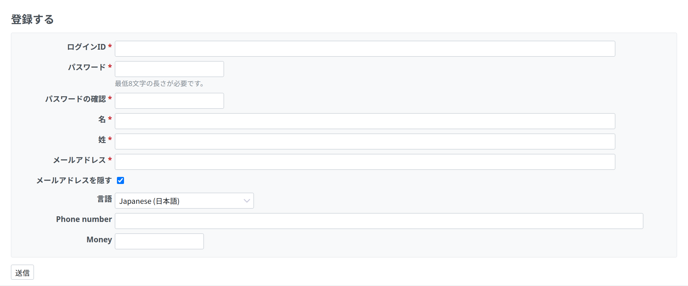
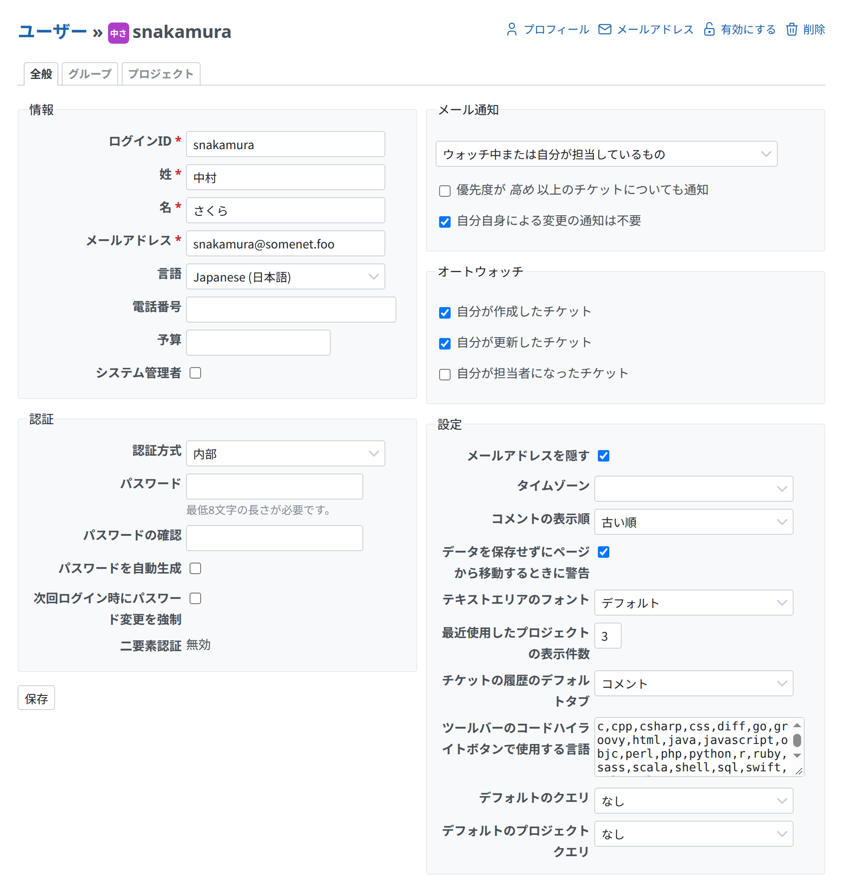

# アカウント登録

アカウント登録のページでは、新しいユーザーが自分でアカウントを登録します。このページには、各ページの右上にある「登録する」のリンクをクリックして移動します。ユーザーによるアカウント登録は、管理者が無効にできます。[「ユーザーによるアカウント登録」の設定](../admin/settings.md#Self-registration)の説明を参照してください。

新しいユーザーは、「ログインID」、「パスワード」、「名」、「姓」、「メールアドレス」と、画面に使う言語を入力します。

## 登録の手順

[Redmine の設定](../admin/settings.md#Self-registration)によって、ユーザーは**メールでアカウントを有効にする**か、**管理者がアカウントを承認するのを待つ**か、**アカウントが自動で有効になる**かのどれかになります。

### メールでアカウントを有効化

アカウント登録のページで必要な情報を入力すると、そのページで入力したメールアドレスにメールが届きます。メールにある有効化のリンクをクリックすると、ユーザーが自分でアカウントを有効にできます。

この方法は、スパムメールを防ぐためによく使われます。

### 手動でアカウントを有効化

アカウント登録のページで必要な情報を入力したあと、ユーザーは管理者の承認を待つ必要があります。管理者は、「管理」 > [「ユーザー」のページ](../admin/users.md)からユーザーを開き、ユーザーのページの右上にある「有効にする」をクリックします。アカウントが有効になると、ユーザーはログインできます。

### 自動でアカウントを有効化

アカウント登録のページで必要な情報を入力すると、ユーザーはいつでもログインできます。ほかの手順はいりません。
