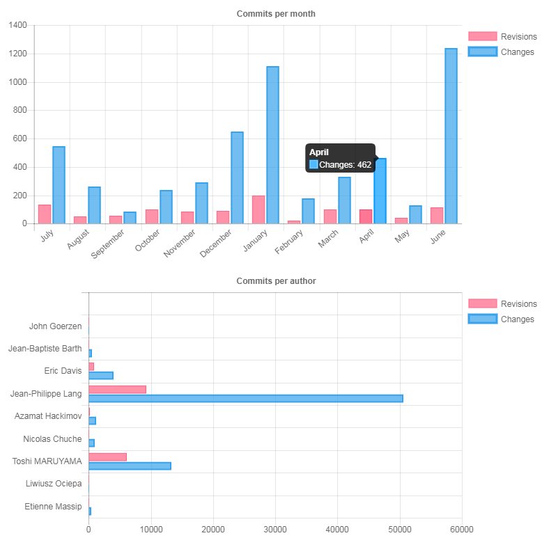

# リポジトリの統計

Redmine は、設定したリポジトリの「変更」の数と「リビジョン」の数を表す 2 つの画像を作ります。1 つの画像は、「変更」と「リビジョン」を月ごとに分けて示します。もう 1 つの画像は、コミッターごとに「変更」と「リビジョン」の数を示します。

## 定義

- 「リビジョン」は、リポジトリへのコミットの数で、赤みがかったオレンジ色で表示されます。
- 「変更」は、全体で変更されたファイルの数で、青で表示されます。

