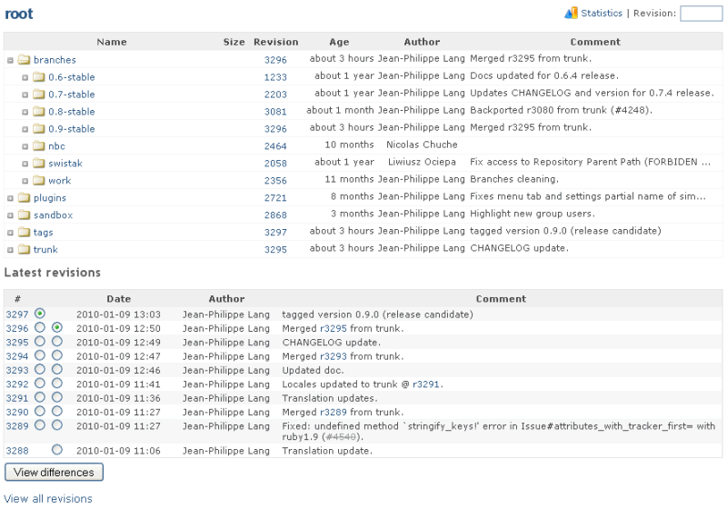

# リポジトリ

「リポジトリ」のタブでは、プロジェクトのリポジトリを閲覧し、最新のコミットを見られます。

ディレクトリは、名前の前にある矢印のアイコンをクリックすると展開できます。\
ディレクトリの名前をクリックして、そのディレクトリに移動することもできます。

リビジョンの番号をクリックすると、コミットの詳細が表示されます。

特定のリビジョンのリポジトリを閲覧するには、右上の欄にリビジョンの番号を入力して Enter キーを押します。

