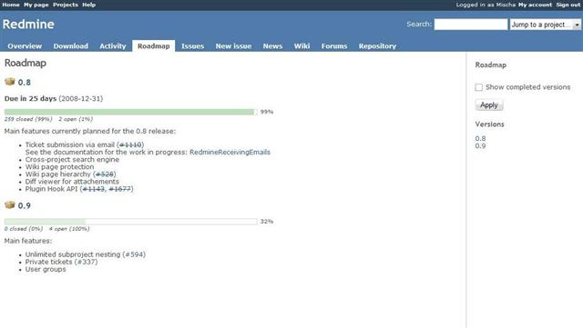

# ロードマップ

ロードマップは、チケットをバージョンごとに見られる、細かく設定できる表示です。プロジェクトの開発の計画と管理に役立ちます。また、プロジェクトの現在の状態を(バージョンごとに)詳しく見渡せます。

*注: プロジェクトのメニューに[ロードマップ](roadmap.md)が表示されるのは、プロジェクトで「チケットトラッキング」の[モジュール](project-settings.md#Core-modules)が有効で、プロジェクトで使える[バージョン](project-settings.md#Versions) ([プロジェクト設定](project-settings.md)で設定したものか、ほかのプロジェクトから共有されたもの) が 1 つ以上あるときだけです。*

## 概要

ロードマップを選ぶと、次のように、プロジェクトの現在の状態の概要が表示されます。

この表示には、すべての(未完了の)バージョンについて、次の情報の「欄」があります。

- バージョンの名前
- バージョンの完了予定日
- 進捗バー。バージョンを対象にしたチケットの進捗率、予定工数、ステータスをもとに、全体の進行中、作業済み、完了の割合を、色のグラデーションで分けて示します
- 設定していれば、バージョンに関連付けるように設定した Wiki ページの内容(下を参照)
- 設定していれば、そのバージョンに割り当てたすべてのチケットの一覧(下を参照)

進捗バーには、特定のフィルタをあらかじめ設定したチケット一覧へのドリルダウンのリンクがあります。これで、バージョンを対象にした未完了や完了のチケットにすばやく移動できます。チケット一覧で未完了のチケットをすべて見るには、「未完了」の左の数をクリックするだけです。解決したチケットや完了したチケットを知りたいときは、「完了」の左の数をクリックするだけです。

バージョンそのもの(バージョンのアイコンの右の 0.8)をクリックすると、特定のバージョンの現在の全体の状態を詳しく見られます。これが[バージョン](version.md)の表示です。

### バージョンの完了率

完了率は、予定工数で各チケットに重みを付けて計算します。\
予定工数のないチケットには、予定工数の平均で重みを付けます。\
予定工数のあるチケットが 1 つもなければ、すべてのチケットに同じ重みを付けます。

詳しくは [#2182](https://www.redmine.org/issues/2182)#note-6 を参照してください。

## ロードマップの管理

適切な権限があれば、ロードマップの表示を 2 つの方法で変えられます。

1.  バージョンに Wiki ページを関連付けられます([プロジェクト設定の「バージョン」](project-settings.md#Versions)を参照)。このページには、バージョンの主な目標などを書けます。
2.  バージョンを対象にした個々のチケットを一覧に表示するトラッカーを選べます。選ぶと、バージョンのすぐ下に、関連するすべてのチケットの欄が表示されます。この動作は、管理者が[トラッカー](../admin/issue-tracking-setup.md#Trackers)の設定で変えられます。

## サイドバー

ロードマップの右にあるサイドバーには、次のものがあります。

- ロードマップに完了した対象バージョンを含めるためのチェックボックス
- ロードマップに、特定のトラッカーのチケットを含めるか除くかを選ぶチェックボックスと「適用」のボタン(ここにチェックボックスで表示されるトラッカーは、それぞれの[トラッカーの設定](../admin/issue-tracking-setup.md#Trackers)によって決まります)
- プロジェクトに設定した対象バージョンへのリンク。それぞれのリンクは、選んだ対象バージョンから始まるロードマップそのものへのリンクです
