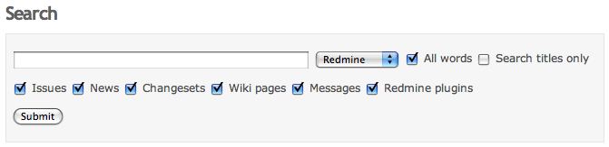
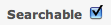
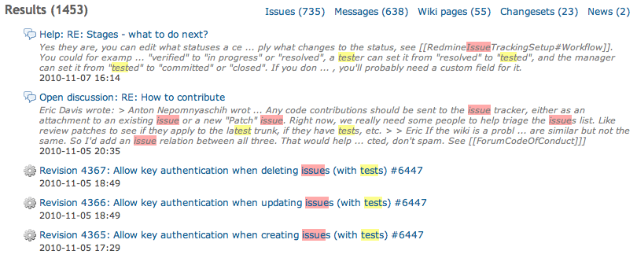

# 検索

どのようなプロジェクト管理でも、既存の情報を探すのに時間の一部が使われます。そこで Redmine の検索機能の出番です。

## 検索ボックス

Redmine の右上に、シンプルな検索ボックスがあります。何か入力して Enter キーを押すと検索します。

\#{IssueID} または {IssueID} で検索すると、そのチケットに直接移動します。検索の語句は二重引用符で囲めます。

権限の設定やプロジェクトのメンバーかどうかによって、ドロップダウンメニューの選択肢に現在のプロジェクトが表示されることがあります。シンプルな検索では、その選択肢で現在表示しているプロジェクトをフルテキスト検索します。

「検索」という文字をクリックすると、すぐに詳細検索と検索結果のページに移動します。プロジェクトの選択が引き継がれていることと、検索を特定の種類の項目に絞るチェックボックスがあることに注目してください。チェックボックスは、そのプロジェクトでモジュールが有効なときだけ表示されます。

## 検索の設定

### タイトルのみ

詳細検索のボックスで「タイトルのみ」を有効にすると、検索結果を絞り込めます。

### カスタムフィールドの検索

カスタムフィールドは、デフォルトでは検索されません。カスタムフィールドも検索するには、カスタムフィールドの「検索対象」のチェックボックスをオンにするのを忘れないでください。

## 検索結果

このサイトで「test issue」を検索した結果のページの例です。

- 見つかったものへの多くのリンク
- 検索語に一致したテキストの強調表示
- 結果のグループ(ニュースなど)への移動
- 結果の種類(更新履歴、チケット、コメントなど)を示す先頭のアイコン

## 検索のコントローラー

まずはソースを確認しましょう。

source:/trunk/app/controllers/search_controller.rb

コントローラーをさらに詳しく見ると、上で説明した動作のいくつかがわかります。

- 検索するのは、検索の語句の最初の 5 つのトークンだけです
- トークンは 2 文字以上である必要があります (漢字は 1 文字でもかまいません)
- 結果は、「ページごとの検索結果表示件数」の設定 (デフォルトは 10) で指定した件数ずつ、ページに分けて返されます
