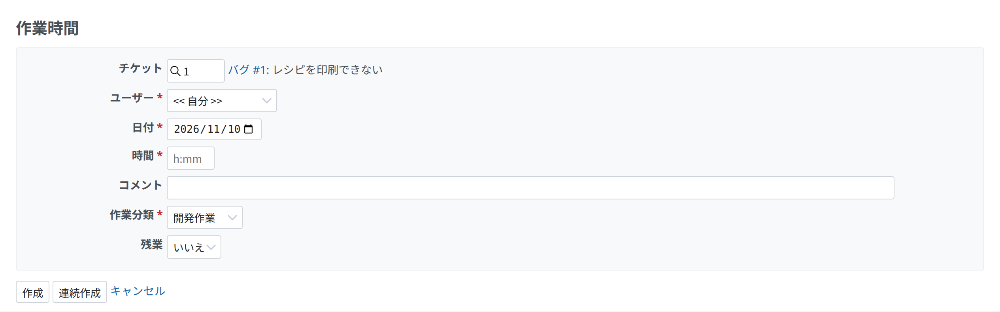
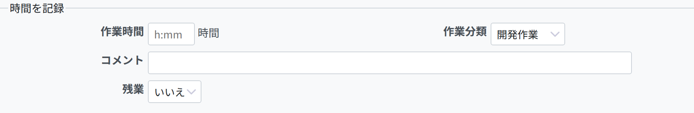

# 時間管理

## はじめに

時間管理では、特定のチケットやプロジェクトに記録した作業の時間を管理できます。「作業時間」の記録は 1 件ごとに作業分類で分けられ、コメントで説明を加えられます。予定工数を入力しておくと、プロジェクトの管理者はより適切なプロジェクトの計画を立てられ、ユーザーそれぞれの進み具合も追えます。

時間管理の記録は必ずユーザーに結び付くため、そのユーザーがこなした請求可能な時間の管理にも使えます。詳しくは、[作業時間の詳細](timelog-details.md)と[作業時間のレポート](timelog-report.md)のページを参照してください。

## インストールと設定

時間管理は Redmine の標準のモジュールです。新しいプロジェクトのフォームの「モジュール」の欄、または既存のプロジェクトの「設定」のタブで、プロジェクトごとに有効または無効にできます。モジュールの設定について詳しくは、[プロジェクト設定](project-settings.md)を参照してください。

## チケットに時間を記録する

チケットの詳細の画面で「時間を記録」をクリックすると、チケットに時間を記録できます。

チケットを更新するときにも、時間を記録できます。

## プロジェクトに時間を記録する

チケットのフィールドを空のままにすると、プロジェクトに時間を記録できます。

## 入力できる時間の形式

予定工数と作業時間は、時間と分を分けて入力するか、まとめて入力します。次の形式を使えます。

1.  分ける: 時間と分を、標準の時間の形式の整数で入力します。**`1h`**、**`1 h`**、**`1 hour`**、**`2 hours`**、**`30m`**、**`30min`**、**`1h30`**、**`1h30m`**、**`1:30`**
2.  まとめる: 時間を 10 進数の時間の形式で、小数で入力します。小数点の記号には、ピリオド (.) とコンマ (,) のどちらも使えます。**`1.5`**、**`1,5`** (`1h30` と同じ)

### 10 進数の時間の形式

Redmine で予定工数や作業時間を [10 進数の時間の形式](http://en.wikipedia.org/wiki/Decimal_time)で入力するときは、「時間の形式」の設定 (「管理」 > 「設定」 > 「表示」) が 10 進数の形式 (0.75) になっていれば、Redmine が時間の合計も 10 進数の時間の形式で表示することに注意してください。デフォルトの形式 (0:45 h) では、時間は「時:分」の形式で表示されます (例: 1:39)。

次の例を考えます。

- プロジェクトに 4 件のチケットがあり、作業時間がそれぞれ **1.00**、**0.10**、**0.15**、**0.40** だとします。作業時間のレポート (プロジェクトの「概要」→「時間管理」→[「詳細」\|「レポート」]) には、10 進数の値の合計の 1.65 時間 (1 時間 39 分) が表示されます。小数点の前を時間、後ろを分として別々に合計した値 (2.05 時間という誤った値) にはなりません。
- *説明*: 4 つの作業時間は 10 進数の時間の形式で入力されているため、これは意図した動作です。値は次のように解釈されます。
  - 10 進数の 1.00 は 60 分 (1 時間)
  - 10 進数の 0.10 は 6 分
  - 10 進数の 0.15 は 9 分
  - 10 進数の 0.40 は 24 分
  - 10 進数の 1.65 は 99 分
  - 2:05 時間 (125 分) は、10 進数の表記で 2.0833333333333335 (概算)

合計の値を表示するときに 10 進数の値を小数点以下 2 桁に丸めるため、わずかな差が出ることがあります (上の 2:05 の例のとおりです)。

参考:

- http://en.wikipedia.org/wiki/Decimal_time
- http://www.springfrog.com/converter/decimal-time.htm

## コミットメッセージで時間を記録する

Redmine と連携する SCM にコミットする開発者には便利な機能として、コミットメッセージでチケットを参照するときに、そのチケットに「作業時間」を記録できます。

この機能を使うには、*管理 -\> 設定 -\> リポジトリ* で「コミット時に作業時間を記録する」のオプションを有効にする必要があります ([ドキュメントを参照](../admin/settings.md#Enable-time-logging))。また、作業時間を記録する作業分類は、*管理 -\> 設定 -\> リポジトリ* の「作業時間の作業分類」のオプションで選びます ([ドキュメントを参照](../admin/settings.md#Activity-for-logged-time))(「デフォルト」を選ぶと、作業時間のデフォルトの作業分類が使われます)。

コミットメッセージの時間の指定には、上の[入力できる時間の形式](time-tracking.md#Accepted-time-formats)のどれでも使えます。ただし、その前に、*管理 -\> 設定 -\> リポジトリ* の「コミットメッセージ内でチケットの参照/修正」で設定した、有効なチケットの参照を書く必要があります ([ドキュメントを参照](../admin/settings.md#Referencing-issues-in-commit-messages))。

デフォルトのチケットの参照用キーワード「refs」を使う例:

Fixed something, refs [#435](https://www.redmine.org/issues/435) @1h30

このコミットメッセージで、チケット #435 に 1 時間 30 分の作業時間が追加されます。
