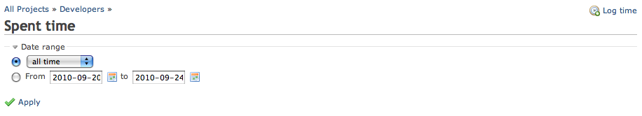
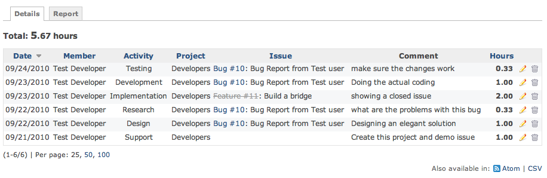

# 作業時間の詳細

## はじめに

Redmine で作業時間を記録していくと、**作業時間の詳細**のページで、プロジェクトに記録した時間の累計を確認できます。

**作業時間の詳細**のページは、「概要」→「作業時間」→「詳細」のメニューから開きます。\
作業時間の機能は、プロジェクトの「時間管理」のモジュールが有効なときにだけ使えます。

## 検索

[作業時間のレポート](timelog-report.md)と同じ検索の画面を使います。

## 結果

デフォルトでは、作業時間の詳細には、システムの**すべての**作業時間が表示されます。

画像の上から順に、次のものがあります。

- 検索の結果の合計の時間
- 作業時間の表(複数のページに分けて表示)
  - 列で並べ替えできる
- Atom と CSV の形式で出力できる

一番下の行にはチケットがありません。この作業時間は、プロジェクトに記録したものです。

リンクは Wiki のほかの部分と同じように動作します。完了したチケットには取り消し線が付きます。

### HTML の出力

### CSV の出力

上の作業時間を CSV で出力した例です(ファイルも添付しています)。

| 日付 | ユーザー | 作業分類 | プロジェクト | チケット | トラッカー | 題名 | 時間 | コメント |
|----|----|----|----|----|----|----|----|----|
| 09/24/2010 | Test Developer | Testing | Developers | 10 | Bug | Bug Report from Test user | 0.333333 | make sure the changes work |
| 09/23/2010 | Test Developer | Development | Developers | 10 | Bug | Bug Report from Test user | 1.0 | Doing the actual coding |
| 09/23/2010 | Test Developer | Implementation | Developers | 11 | Feature | Build a bridge | 2.0 | showing a closed issue |
| 09/22/2010 | Test Developer | Research | Developers | 10 | Bug | Bug Report from Test user | 0.333333 | what are the problems with this bug |
| 09/22/2010 | Test Developer | Design | Developers | 10 | Bug | Bug Report from Test user | 1.0 | Designing an elegant solution |
| 09/21/2010 | Test Developer | Support | Developers |  |  |  | 1.0 | Create this project and demo issue |
