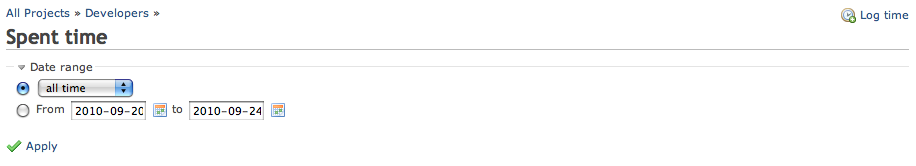
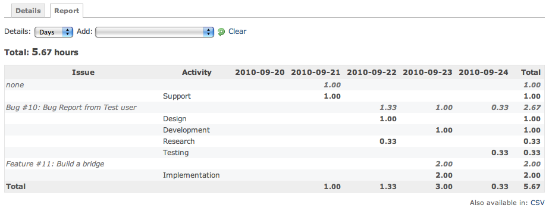

# 作業時間のレポート

## はじめに

作業時間は[個別に詳しく](timelog-details.md)確認できますが、レポートの形式で見たいこともあります。

**作業時間のレポート**では、時間を分類ごとにまとめて表示できます。

**作業時間のレポート**のページは、プロジェクトのメニューの「作業時間」にある「レポート」のタブです (「概要」の「時間管理」の欄からもリンクしています)。\
作業時間の機能は、プロジェクトの「時間管理」のモジュールが有効なときにだけ使えます。

## 検索

[作業時間の詳細](timelog-details.md)と同じ検索の画面を使います。

## 結果

### HTML の出力

この結果は、ドロップダウンで選んだ内容にもとづいて、[作業時間の詳細](timelog-details.md)にある個々の作業時間から作られます。

この例では、「詳細」のパラメーターに「日」を設定しています。

レポートを表示するには、まとめる項目を「追加」します。何か追加するまで、この部分には何も表示されません。この例では、最初に「チケット」、次に「作業分類」を選んでいます。選ぶたびに、一覧は空の状態に戻ります。追加できる組み合わせの最大数に達すると、ドロップダウンは無効になります。最初からやり直すには「クリア」のボタンを使います。

### CSV の出力

| チケット | 作業分類 | 2010-09-20 | 2010-09-21 | 2010-09-22 | 2010-09-23 | 2010-09-24 | 合計 |
|----|----|----|----|----|----|----|----|
| なし |  |  | 1.00 |  |  |  | 1.00 |
|  | Support |  | 1.00 |  |  |  | 1.00 |
| Bug [#10](https://www.redmine.org/issues/10): Bug Report from Test user |  |  |  | 1.33 | 1.00 | 0.33 | 2.67 |
|  | Design |  |  | 1.00 |  |  | 1.00 |
|  | Development |  |  |  | 1.00 |  | 1.00 |
|  | Research |  |  | 0.33 |  |  | 0.33 |
|  | Testing |  |  |  |  | 0.33 | 0.33 |
| Feature [#11](https://www.redmine.org/issues/11): Build a bridge |  |  |  |  | 2.00 |  | 2.00 |
|  | Implementation |  |  |  | 2.00 |  | 2.00 |
| 合計 |  |  | 1.00 | 1.33 | 3.00 | 0.33 | 5.67 |
