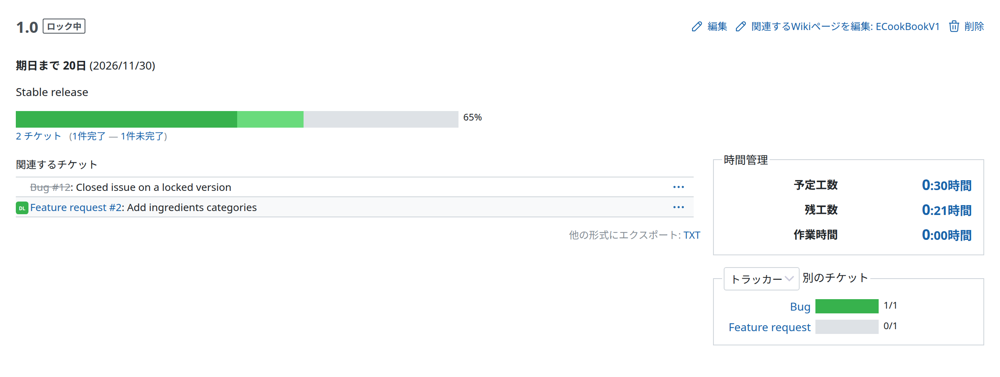

# バージョン

バージョンの概要では、特定のバージョンの現在の全体の状態を詳しく見られます。次のものが表示されます。

- そのバージョンに割り当てたすべてのチケットの一覧。チケットの進捗率とステータスをもとに、全体の進行中、作業済み、完了の割合を色のグラデーションで分けて示す進捗バーもあります
- バージョンに関連付けるように設定した Wiki ページの内容
- バージョンに割り当てたチケットの予定工数と作業時間の合計を示す欄
- 同じ進行中、作業済み、完了の割合の進捗バーで、次の項目ごとにチケットの統計を示す欄
  - 担当者
  - 作成者
  - カテゴリ
  - 優先度
  - トラッカー
  - ステータス

グループ化の基準になる項目と、統計そのもの (チケットの数) のどちらにも、特定のフィルタをあらかじめ設定したチケット一覧へのドリルダウンのリンクがあります。これで、特定の作成者やカテゴリなどのチケットにすばやく移動できます。

バージョンの表示には、[ロードマップ](roadmap.md)で特定のバージョンをクリックして移動します。
