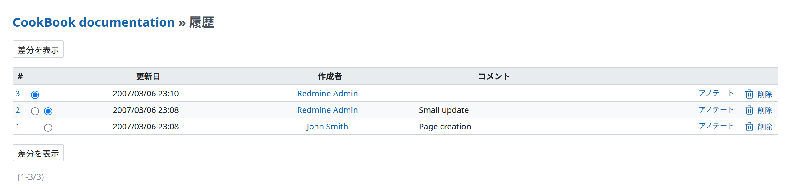
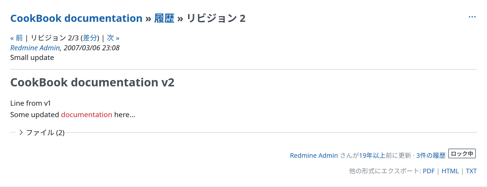

# Wiki

## 新しい Wiki ページの作成

ほかの Wiki と同じように、作りたいページへのリンクを追加するだけです。

    [[MyNewWikiPage]]

ページを保存してそのリンクをクリックすると、「MyNewWikiPage」という名前の新しい Wiki ページの編集になります。この後は、下の「編集」の説明に従います。

## 子ページの作成(親子関係)

Wiki ページどうしに親子関係を設定できます。これには 2 つの利点があります。

- 「索引(名前順)」で、ページのツリーが親子関係に従って並びます:\
  \> \* Guide\
  \> RedmineAccounts\
  \> RedmineCustomFields\
  \> RedmineInstall\
  \> RedmineIssueList\
  \> RedmineIssues
- 子ページには、ページのツリーの中でのページの位置を示す階層リンクが表示されます:\
  TODO、画像を追加する

この関係は、子にするページに親ページを指定して設定します。

## ツールバー

Wiki ページの右上には、ページへの操作のボタンが並んだツールバーがあります。「編集」と「ウォッチ」はボタンとして表示され、そのほかの操作 (「履歴」、「ロック」または「アンロック」、「名前変更」、「削除」、「新しいWikiページ」) は「操作」のメニューにあります。サイトの[ロールと権限](../admin/roles.md)によっては、操作の一部を行う権限がユーザーにないことがあります。その場合、その操作のボタンは表示されません。

それぞれの操作を次に説明します。

### 編集

Wiki ページの現在の内容を編集するには、「編集」のボタンをクリックします。テキストの書き方について詳しくは、[テキスト書式](text-formatting.md)を参照してください。ページの親は、「親ページ」のドロップダウンで変えられます。

### ウォッチ

「ウォッチ」のボタンをクリックすると、自分がそのページのウォッチャーに追加されます。ページが変更されると、メールで通知が届きます。

### 名前変更(または移動)

Wiki ページの名前を変える、または Wiki ページとその子ページをほかのプロジェクトに移動するには、「名前変更」のボタンをクリックします。

「既存のリンクをリダイレクトする」にチェックを入れると、名前の変更や移動のときに、現在のページへの既存のリンクが新しい Wiki ページにリダイレクトされます。ほかのプロジェクトに移動した子ページへのリンクは、リダイレクトされません。リダイレクトを止めるには、[#6401](https://www.redmine.org/issues/6401)#note-8 の回避策を参照してください。

「親ページ」で親ページを指定できます。

「プロジェクト」で移動先のプロジェクトを指定すると、ページをほかのプロジェクトに移動できます。ページを移動すると、子ページも一緒に移動します。ただし、移動先のプロジェクトに同じ名前のページがある子ページは移動しません。

### ロック(保護)

「ロック」のボタンをクリックするとページがロックされ、ボタンは「アンロック」に変わります。

ロックした Wiki ページは、「Wikiページの保護」の権限のあるユーザーだけが編集できます。このユーザーは、「アンロック」をクリックしてロックを解除することもできます。

### 削除

Wiki ページを削除するには、「削除」をクリックします。この操作には確認が必要です。

### 履歴

Redmine は、Wiki ページへの変更をすべて記録します。「履歴」をクリックすると、変更の一覧を見られます。

ページの特定のバージョンを見るには、その番号をクリックします。

表示の意味は誤解しやすいので注意してください。`リビジョン 31/41 (差分)` は、41 のうちリビジョン 31 を見ていることを示します。差分のリンクで 31 と 41 の差分が表示されるわけではありません。表示されるのは、リビジョン 30 と 31 の差分です。リビジョン 30 を見ているときは `リビジョン 30/41` と表示され、差分のリンクではリビジョン 30 での変更が表示されます。

40 と 41 の差分を見るには、リビジョンの一覧で「差分を表示」をクリックします(デフォルトでは、最新のバージョンの差分が表示されます)。

以前のバージョンにページを戻すには、「このバージョンにロールバック」をクリックしてから「保存」をクリックします。この場合、Wiki ページの履歴を失わずに、ページの新しいバージョンが作られます。

Wiki ページの履歴をすべて削除したい場合は、そのページの内容を安全な場所にコピーし(編集の画面でコピーして貼り付ける)、ページを削除して、同じ名前で作り直します。その後、コピーした内容を貼り付け直します。「Wikiページの削除」の権限のあるユーザーは、履歴の一覧から個々のバージョンを削除できます。

## サイドバー

「`Sidebar`」という名前の Wiki ページがあると、その内容が Wiki のサイドバーに表示されます。このページを作るには、「Wikiページの保護」の権限が必要です。\
Wiki ページの右にあるサイドバーには、次のリンクがあります。

- 「メインページ」: Wiki の[設定したメインページ](project-settings.md#Wiki)へのリンク
- 「索引(名前順)」: すべての Wiki ページを名前順に並べた索引([設定](wikis.md#Creating-sub-pages-parentchild-relationships)していれば、親子関係にも従って並びます)

TODO、画像を追加する

- 「索引(日付順)」: すべての Wiki ページを最終更新日の順に並べた索引

TODO、画像を追加する
